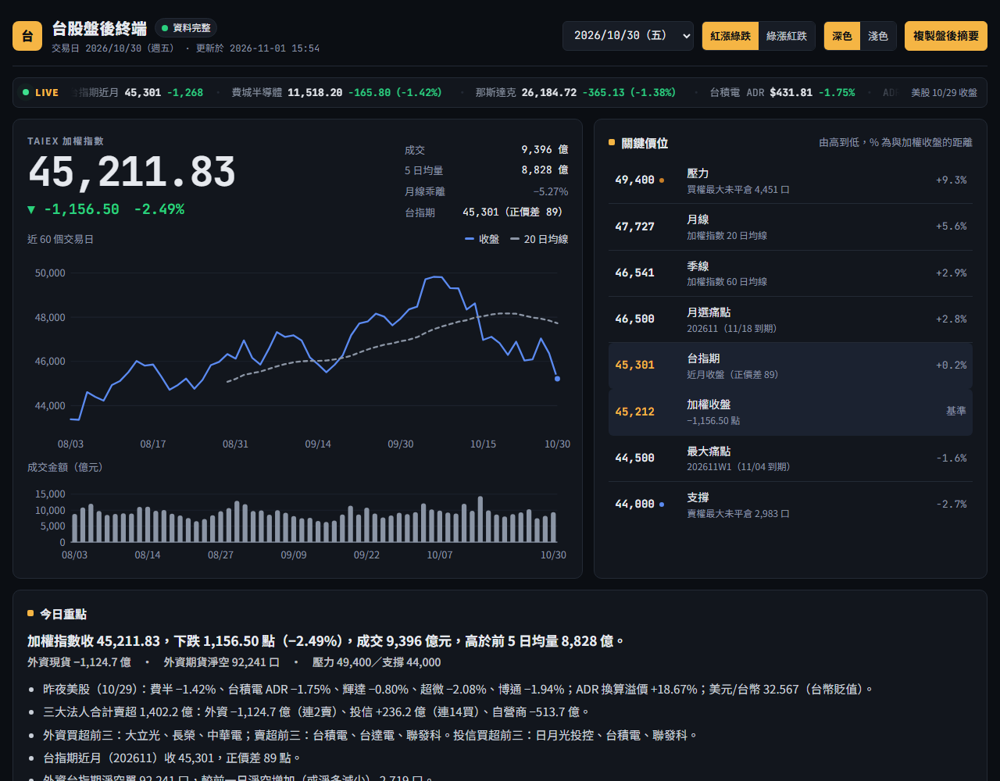
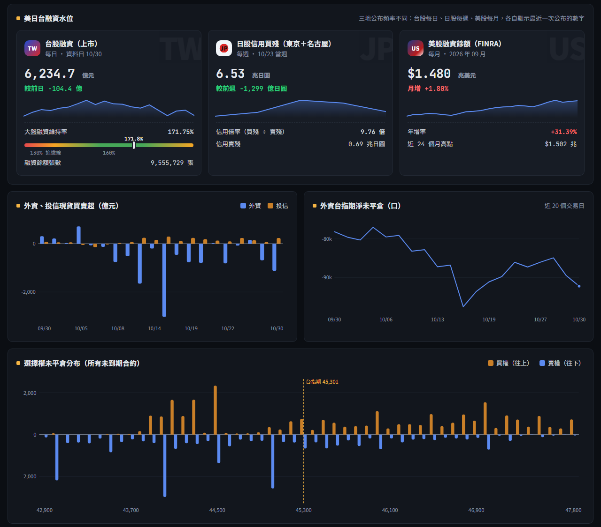
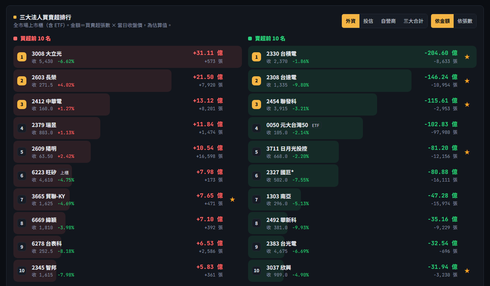
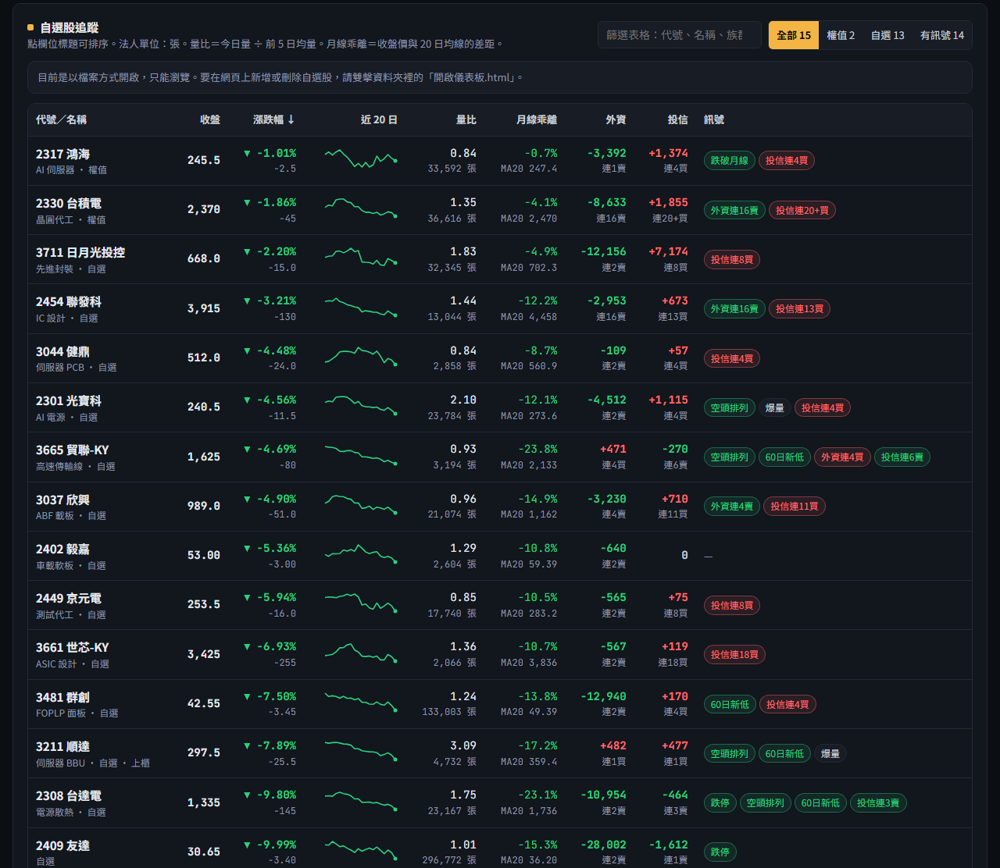

# 台股盤後自動化儀表板

每個交易日收盤後，自動從證交所、櫃買中心、期交所等公開資料抓取最新數據，產生一份「交易終端」風格的台股盤後儀表板。

- 全部使用**免費公開資料**，不需要註冊或 API 金鑰
- 只用 Python 內建模組，**不需要安裝任何套件**
- 可以直接在網頁上**新增或刪除自選股**，有新資料時頁面會**自動更新**

**🌐 線上版：<https://b3879121-rgb.github.io/-automarket/>**（每天收盤後自動更新，唯讀）



---

## 功能一覽

### 指數、關鍵價位與今日重點

- **跑馬燈**：台指期、費半、那斯達克、台積電 ADR（含換算溢價）、美國科技股、美元/台幣、美債 10 年殖利率、VIX
- **加權指數**：收盤、漲跌、成交量、月線乖離，搭配近 60 日走勢與成交金額
- **關鍵價位**：由選擇權未平倉算出的壓力與支撐、最大痛點（週選與月選）、月線、季線
- **今日重點**：依當天數據自動產生的文字摘要，一鍵複製就能貼到 LINE 或筆記

### 美日台融資與籌碼圖表



- **美日台融資水位**：台股融資餘額與大盤融資維持率（每日）、日股信用買殘與信用倍率（每週）、美股 Margin Debt（每月）
- **外資、投信現貨買賣超**：近 20 個交易日
- **外資台指期淨未平倉**：近 20 個交易日
- **選擇權未平倉分布**：所有未到期合約加總，標出台指期目前位置

### 三大法人買賣超排行



- 全市場上市櫃股票與 ETF，可切換**外資／投信／自營商／三大合計**
- 依**金額**或**張數**排序，買超、賣超各列前 10 名
- 按「＋」直接加入自選股，★ 代表已在自選

### 自選股追蹤



- 收盤、漲跌幅、近 20 日走勢、量比、月線乖離、外資與投信買賣超及連續天數
- 自動標出訊號：漲停／跌停、站上／跌破月線、多頭／空頭排列、60 日新高／新低、爆量、法人連買連賣
- 在網頁上搜尋代號或名稱即可新增，按 × 兩次即可刪除

### 其他

- **明日觀察清單**：依當天資料自動產生，也可以自己新增項目
- **持股損益試算**：計入手續費（可設折數）與證交稅，並依可承受虧損反推最多能買幾張
- **日期選單**：切換查看過去每一天的報告
- **紅漲綠跌／綠漲紅跌**、**深色／淺色**主題切換，手機版自動調整版面

---

## 安裝與設定

### 需求

- Windows 10 / 11
- [Python 3.13](https://www.python.org/downloads/)（安裝在預設位置 `%LOCALAPPDATA%\Programs\Python\Python313`）

> 批次檔與排程使用上面這個 Python 路徑。如果你的 Python 裝在別的位置，請修改 `run_after_close.bat`、`啟動儀表板伺服器.bat` 和 `setup_schedule.ps1` 裡的路徑。

### 線上版（GitHub Pages）

到 repo 的 **Settings → Pages**，Branch 選 `main`、資料夾選 `/ (root)` 後儲存，1～2 分鐘後就能從 `https://<帳號>.github.io/<repo 名稱>/` 開啟。線上版是唯讀的，新增或刪除自選股請在自己電腦上的儀表板操作。

### 第一次設定（只要做一次）

1. 下載或 clone 這個 repo
2. 在 **`setup_schedule.ps1`** 上按右鍵 →「用 PowerShell 執行」，它會：
   - 建立每日抓資料的排程（平日 16:30、21:30）
   - 設定登入 Windows 時，自動在背景啟動儀表板伺服器
3. 先手動抓一次資料（把日期換成最近的交易日）：

```powershell
& "$env:LOCALAPPDATA\Programs\Python\Python313\python.exe" fetch_after_close.py --date 2026-10-30
```

```powershell
& "$env:LOCALAPPDATA\Programs\Python\Python313\python.exe" build_dashboard.py
```

4. 雙擊 **`開啟儀表板.html`** 打開儀表板

儀表板伺服器只接受本機連線（`127.0.0.1:8765`），其他電腦連不進來。臨時想手動啟動，雙擊 **`啟動儀表板伺服器.bat`** 即可。伺服器沒開時，`開啟儀表板.html` 會改開唯讀版。

---

## 使用方式

### 每天自動執行

| 時間 | 做什麼 |
|---|---|
| 平日 16:30 | 抓盤後主要資料、產生儀表板。資料還沒公布齊全時，每 15 分鐘重試一次，最晚到 18:30 |
| 平日 21:30 | 補上晚上才公布的台股融資餘額與維持率 |

每次執行完都會把新的資料與儀表板推送到 GitHub，線上版跟著更新（只推送 `data/`、`reports/` 和自選股清單，程式碼的修改不會自動推送）。

- 國定假日自動略過
- 排定時間電腦沒開機的話，開機後會自動補跑（睡眠中不會執行）

### 修改自選股

**在網頁上**（建議）：在「自選股追蹤」的輸入框打代號或名稱（例如 `2603` 或 `長榮`），從建議清單點選或按 Enter。第一次加入某檔股票約需 10～20 秒下載歷史資料。

**直接改檔案**：編輯 `watchlist.csv`，一行一檔，上市、上櫃都可以：

```
代號,名稱,族群,分類
2330,台積電,晶圓代工,權值
3211,順達,伺服器 BBU,自選
```

跑馬燈的美股與匯率清單在 `us_watchlist.csv`，代號使用 Yahoo Finance 格式（例如指數 `^SOX`、匯率 `TWD=X`）。

### 手動指令

| 指令 | 用途 |
|---|---|
| `python fetch_after_close.py --date 2026-10-30` | 補抓指定日期的資料 |
| `python fetch_after_close.py --wait` | 抓今天的資料，不齊就重試到 18:30 |
| `python build_dashboard.py` | 用最新資料產生儀表板 |
| `python build_dashboard.py --all` | 所有日期的儀表板重新產生（改過 `template.html` 後用） |
| `python server.py` | 啟動儀表板伺服器 |

> 這台電腦上的 `python` 指令可能指向 Windows 商店的捷徑，請改用完整路徑 `%LOCALAPPDATA%\Programs\Python\Python313\python.exe`。

---

## 檔案結構

| 檔案／資料夾 | 用途 |
|---|---|
| `fetch_after_close.py` | 抓取並計算所有盤後資料 |
| `build_dashboard.py` | 把資料套進 `template.html`，產生儀表板 |
| `server.py` | 本機伺服器：網頁新增／刪除自選股、永遠顯示最新資料 |
| `common.py` | 共用工具：網路請求、快取、日期、Excel 讀取 |
| `template.html` | 儀表板的版面與互動程式 |
| `watchlist.csv` | 自選股清單 |
| `us_watchlist.csv` | 跑馬燈的美股與匯率清單 |
| `publish_github.py` | 把每天的新資料推送到 GitHub，更新線上版 |
| `index.html` | 線上版首頁，自動跳到最新儀表板 |
| `run_after_close.bat` | 排程執行的檔案（抓資料 → 產生儀表板 → 推送到 GitHub） |
| `setup_schedule.ps1` | 建立／重設 Windows 工作排程 |
| `啟動儀表板伺服器.bat` | 手動啟動伺服器並打開儀表板 |
| `開啟儀表板.html` | 打開儀表板的捷徑（自動判斷可編輯版或唯讀版） |
| `data/` | 每天抓到的資料（JSON），累積成歷史 |
| `reports/` | 每天產生的儀表板，`latest.html` 永遠是最新一天 |
| `docs/images/` | README 使用的截圖 |
| `morning_market_dashboard.html` | 最初的設計稿，保留作參考 |

執行時還會產生 `cache/`（已定案的過去資料，避免重複下載）和 `logs/`（執行紀錄），這兩個資料夾不會上傳到 GitHub。

---

## 資料來源

| 資料 | 來源 | 大約公布時間 |
|---|---|---|
| 加權指數、成交金額、個股收盤 | 臺灣證券交易所、證券櫃檯買賣中心 | 14:00 前後 |
| 三大法人買賣超（大盤、個股） | 臺灣證券交易所、證券櫃檯買賣中心 | 15:00～16:00 |
| 台指期行情、期貨法人未平倉、選擇權未平倉、P/C 比 | 臺灣期貨交易所 | 15:00 前後 |
| 台股融資餘額 | 臺灣證券交易所（上市） | 每日晚上 |
| 費半、美股、台積電 ADR、美元/台幣、美債殖利率、VIX | Yahoo Finance | 台灣時間前一晚的美股收盤 |
| 日股信用買殘、信用倍率 | 日本取引所グループ（東京＋名古屋） | 每週 |
| 美股融資餘額（Margin Debt） | FINRA | 每月（約次月第三週） |

## 數字怎麼算

| 項目 | 計算方式 |
|---|---|
| 壓力 | 所有未到期台指選擇權加總後，現價以上 10% 內買權未平倉最多的履約價 |
| 支撐 | 現價以下 10% 內賣權未平倉最多的履約價 |
| 最大痛點 | 結算在該價位時選擇權買方總價值最小的履約價，分別計算最近到期合約與月選 |
| 法人買賣超金額 | 買賣超張數 × 當日收盤價（估算值） |
| 大盤融資維持率 | Σ（每檔上市股票融資餘額 × 收盤價）÷ 上市融資總金額 |
| ADR 換算溢價 | 台積電 ADR 收盤 × 美元/台幣 ÷ 5，再與台積電收盤比較 |
| 信用倍率（日股） | 信用買殘股數 ÷ 信用賣殘股數 |
| 量比 | 今日成交量 ÷ 前 5 日平均成交量 |
| 月線乖離 | （收盤價 − 20 日均線）÷ 20 日均線 |
| 連買／連賣 | 法人連續買超或賣超的天數，最多算到 20 天 |

---

## 免責聲明

本專案的所有數字、關鍵價位與訊號，都是依公開資料機械式計算的結果，**僅供參考，不構成任何投資建議**。資料以各交易所公告為準，投資請自行判斷並承擔風險。
